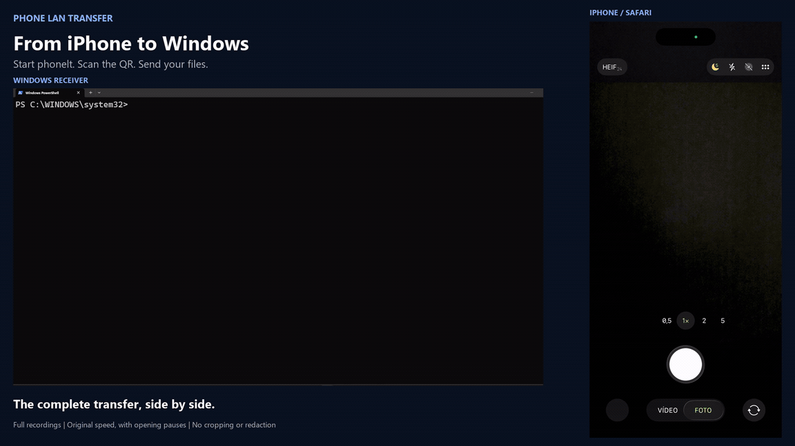

# Phone LAN Transfer

Transfer files from a mobile device directly to a computer over a local network, without installing a mobile app.

## Demo

Review and rename files on an iPhone, send them together, and find them on Windows.

[](docs/media/phone-lan-transfer-demo.mp4)

[Watch the complete 59-second Full HD video](docs/media/phone-lan-transfer-demo.mp4) ·
[Still preview](docs/media/phone-lan-transfer-demo-poster.png)

Both screen recordings are shown in full, synchronized side by side. Opening
pauses leave time to read the typed `phonelt` command; the recordings otherwise
play at their original speed. No audio. This review version is unredacted.
QR access expires when its server session stops.

## Why I built this

I have often needed a simple way to move photos, videos, and other files from my iPhone to my computer. Instead of only looking for an existing tool, I decided to build one myself. The project now targets modern mobile browsers and desktop operating systems while keeping iPhone with Safari to Windows as the first reference combination. This gives me a practical problem through which to learn software engineering: breaking a task into small parts, evaluating technical choices, and understanding the solution well enough to explain and improve it.

> **Project status:** Working development version. Individual and sequential
> batch uploads, previews, destination names, upload progress, manual retries,
> and reload access recovery are implemented. Recorded ZIP transfers passed
> size and SHA-256 verification on iPhone/Safari to Windows and Android/Chrome
> to macOS. See [manual verification](docs/TESTING.md) for the exact scope;
> broader compatibility and standalone desktop packages remain future work.

## Implemented features

- A local web server on the computer and a QR code that opens the upload page in a mobile browser.
- A fresh access token each time the server starts.
- Multiple-file selection, previews, destination-name editing, and Review all files.
- Individual Send actions or sequential Send all, per-file and total progress, errors, and manual retries.
- Streaming writes, validated filenames, collision rejection, and a configurable file size limit.
- Command-line options for the port and destination folder.

## Installation and usage

### Use the application

This development version requires Python 3.11+ and
[`uv`](https://docs.astral.sh/uv/). It is not yet a standalone desktop download.
Git is also required. Clone the project once and install its command with the
runtime dependency versions recorded in `uv.lock`:

```powershell
git clone https://github.com/NelBanque/phone-lan-transfer.git
cd phone-lan-transfer
python scripts/install_tool.py
```

If you already have a checkout, run only `python scripts/install_tool.py` from
that folder. The script installs an editable user tool, so it follows the local
source. Keep the folder in place; rerun the script after moving it or updating
`uv.lock`. It exports constraints without changing the lockfile. If `python` is
named `python3` on your system, use that command instead. If `phonelt` is not
found after installation, run `uv tool update-shell` and reopen your terminal.

Start reception on a trusted local network:

```powershell
phonelt
```

The terminal shows the receiving folder, maximum size, QR code, and access URL.
Keep the server running, scan the QR on your phone, select a file, and tap Send.
Both devices must be able to reach each other on the same trusted network.
Wait for Saved before closing the page. Stop the server with Ctrl+C.

Defaults: the system Downloads folder's `Phone LAN Transfer` subfolder,
5 GiB per file, port 8000, and LAN access enabled. The receiving subfolder is
created and checked with a temporary write before the QR is displayed. The
startup summary shows its full path. Folder problems stop startup with guidance.
Use `-d` if you want another location; existing files are never overwritten.

```powershell
phonelt -h
phonelt -m 10
phonelt -m 0.5 -d "D:\Received files"
phonelt -p 9000
phonelt --local-only
```

| Option | Short form | Purpose |
| --- | --- | --- |
| `--help` | `-h` | Show options and examples without starting the server. |
| `--destination PATH` | `-d PATH` | Choose the receiving folder. Relative paths use the startup directory. |
| `--max-gib GIB` | `-m GIB` | Set a positive per-file limit in GiB; decimal values must represent whole bytes. |
| `--port PORT` | `-p PORT` | Set the listening port. |
| `--local-only` | | Listen only on this computer, without a phone QR. |
| `--lan-address IPV4` | | Override the address shown to the phone, for VPN/multiple interfaces. |
| `--max-file-bytes BYTES` | | Advanced exact-byte limit; cannot be combined with `-m`. |

Use `-h` or `--help`, not `-help`. `phone-lan-transfer` remains an equivalent
command, and the old `--lan` flag is accepted but no longer required.
HTTP is unencrypted; never expose the server to the internet.

### Develop or run a local checkout

The current development server requires Python 3.11+ and
[`uv`](https://docs.astral.sh/uv/). Prepare the environment and start the
server with:

```bash
uv sync --locked
uv run --locked phonelt
```

Open <http://127.0.0.1:8000/health> to verify that the server returns
`{"status":"ok"}`. With `--local-only`, only this computer can connect.
The default startup enables LAN access.

To run only on this computer:

```bash
uv run phonelt --local-only
```

Use `--port 9000` to select a different port. LAN mode prints both an access
URL and a terminal QR code for the phone. The root URL serves a responsive
browser page that reads the temporary link and lets you select, review, and
remove files. Images and videos can be previewed when the browser supports
their formats. You can set a destination name while keeping the file extension;
the phone's original file is not renamed. The page validates the token by
requesting the active file-size limit and warns about files that exceed it.
Destination-name feedback checks the full name against the server's 255-byte
UTF-8 rule and identifies reserved names and forbidden characters. The server
still validates every upload independently.
The page removes the token from the URL and keeps it in `sessionStorage` so
reloading the same tab can recover access. A new QR token replaces the stored
one; a server 401 response clears it. Restarting the server invalidates old
tokens. Selected files are not restored after reload. If browser storage is
blocked, the QR works for the current page, but reload requires reopening it.
Storage remains accessible to scripts on the same origin. Browser session
restoration or tab duplication may retain it; closing a tab is not revocation.
Use Send all to transfer pending files in order, or each file's Send button to
transfer it separately. Review all files opens their previews and destination
name fields together; Hide details returns to the compact list. Send all waits
for each file's save result before starting the next. Failed files keep their
own errors and require an individual retry after checking the receiving folder.
Clear saved removes confirmed entries from this list without deleting files on
the computer. It is unavailable while sending. The total progress bar appears
only during an active batch below 100%; at 100%, it disappears while the status
still waits for save confirmation. The final save results remain visible.
While Send all runs, a total progress bar weighs each file by its byte size.
Its percentage measures bytes sent, so 100% still waits for the computer's
save confirmation and is not a claim that every file was saved. Each file also
shows its own progress. File bytes are transferred directly without image
conversion or recompression.
Names cannot be edited while
sending or after a confirmed save. Failed files offer Retry; existing names
require correction. If a save cannot be confirmed after a connection failure,
check the receiving folder before retrying. A retry never overwrites an
existing file. An upload is aborted after two minutes without byte progress;
after sending completes, save confirmation also has a two-minute deadline.
Ongoing byte progress renews the upload timer, so a large file can take longer.
A connection failure, inactivity expiry, or invalid save confirmation pauses
Send all and leaves later files pending. Check the computer before retrying the
affected file or starting the remaining files. Browser suspension may delay
timers. Do not use LAN mode on a public or untrusted network.

If automatic address detection selects the wrong interface on a computer with
a VPN or multiple network connections, set the phone-facing IPv4 address
manually:

```bash
uv run phonelt --lan-address 192.168.1.25
```

This changes the address printed in the access URL and encoded in the QR code.
The server still listens on all IPv4 interfaces in default LAN mode.

Set the receiving folder and per-file byte limit at startup:

```bash
uv run phonelt -d "received files" -m 5
```

The defaults are system Downloads/Phone LAN Transfer and 5 GiB per
file. Storage receives a positive integer number of bytes. CLI startup creates
the folder and verifies a temporary write, then removes the probe. This check
does not reserve space or guarantee that permissions and storage stay available;
the upload endpoint still handles write failures. Creating the app directly
does not run the CLI check. The browser displays the active limit.

### Development upload API

`GET /transfer-settings` returns the active per-file limit in bytes, for example
`{"max_file_bytes":5368709120}`. It requires the current Bearer token and does
not expose the receiving folder. The browser queries it before enabling file
selection. Connection errors offer a retry; invalid tokens require reopening
the current QR link. The page displays the limit and flags oversized files.

`POST /uploads?destination_name=<URL-encoded filename>` accepts one file as
the raw request body. Send the current token in `Authorization: Bearer <token>`.
This is not a multipart form upload. The server reads network chunks directly
into the configured receiving folder and enforces the limit while writing,
even when the request has no `Content-Length` header.

After the write and file close succeed, the response is HTTP 201 with
`{"status":"saved","destination_name":"photo.jpg"}`. This does not guarantee
durability across power loss. Errors include 400 for an invalid name or an
interrupted upload, 401 for invalid authentication, 409 for an existing name,
413 for exceeding the limit, 507 for insufficient disk space, and 500 for other
storage failures. A missing destination name returns 422. Handled write or
connection failures remove the partial file; an abrupt process or power loss
may still leave one. A disconnected phone may not receive the error response.

The API has automated Windows tests, including separate network chunks and
disconnect cleanup. On 2026-10-27, a user manually sent a file from a phone
through the browser and confirmed receipt on Windows. The phone OS, browser
version, file format, and byte-for-byte integrity were not recorded; this is
an initial smoke test rather than a compatibility claim. A later recorded
iPhone/Safari-to-Windows ZIP transfer passed size and SHA-256 verification;
see [manual verification](docs/TESTING.md) for the test scope and limitations.

## Architecture

The receiving computer hosts a local FastAPI server. The mobile browser opens
the QR link and sends selected files directly into the configured folder. See
[architecture and file journey](docs/ARCHITECTURE.md) for component responsibilities,
authentication, streaming storage, and save confirmation.

The core is designed for mobile devices with modern browsers and for Windows, macOS, and Linux receivers. This includes combinations such as iPhone to Windows, Android to macOS, or a tablet to Linux. Compatibility will be claimed only after each combination is tested. The first reference combination is iPhone with Safari to Windows.

## Development checks

Run `uv run --locked pytest` and `uv run --locked ruff check .` for the Python checks.
With Node.js installed, run `node --test tests/browser-settings.test.cjs` to
check the browser settings flow with simulated network responses and page elements.
These checks do not replace testing in a real mobile browser.

## Known limitations and security

- This tool is intended only for trusted local networks. Do not expose its server to the internet.
- The mobile device and computer must be able to reach each other on the same network. Guest, hotel, and university networks may block device-to-device connections.
- The receiving computer's firewall may ask for permission or require a local-network rule when the server first starts.
- File selection, available file providers, paths, permissions, and firewall behavior can vary across browsers and operating systems.
- Transferred files should be treated as untrusted unless they come from a device and source you trust.
- The HTTP connection is unencrypted. Other devices with the ability to observe traffic on the network may see uploaded files or the access token. See [security guidance](docs/SECURITY.md).

## Roadmap

1. Repository setup and a minimal server.
2. QR access and a browser upload page.
3. Validate streaming uploads and document manual acceptance for the MVP (`v0.1.0`).
4. Compatibility testing for Android browsers and macOS and Linux receivers.
5. Optional HEIC conversion, EXIF date organization, and duplicate detection.
6. Local administration page and platform-specific desktop packages.

## License

This project is licensed under the MIT License. See [LICENSE](LICENSE).
