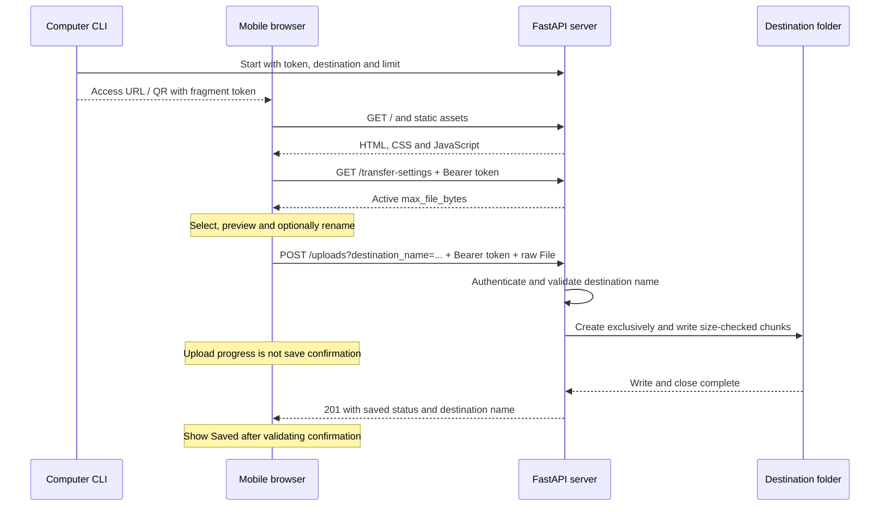

# Architecture

Phone LAN Transfer runs a local Python server on the receiving computer and
serves a browser interface to the sending device. Files go directly to the
configured receiving folder. There is no cloud relay or second browser download
on the computer. Use it only on a trusted local network: HTTP is unencrypted.

## Components

| Component | Responsibility |
| --- | --- |
| `cli.py`, `network.py` | Parse startup options, choose the listening address, and print the phone-facing URL and QR. |
| `config.py` | Resolve the receiving folder and hold immutable settings for one server run. |
| `main.py` | Build the FastAPI application, store its token/settings, serve the page/assets, and expose health and active-limit routes. |
| `access.py` | Generate temporary tokens and validate Bearer authorization before protected handlers run. |
| `static/index.html`, `styles.css`, `app.js` | Display selection, previews, destination-name feedback, uploads, progress, and per-file results. |
| `uploads.py` | Adapt the HTTP body stream to storage and translate expected failures into HTTP responses. |
| `filenames.py`, `storage.py` | Validate destination names, create files exclusively, count incoming bytes, write chunks, and clean up failed transfers. |

## One file's journey

### 1. Start the receiver

The CLI creates a fresh random token and `TransferSettings`. The default
destination is the system Downloads folder's `Phone LAN Transfer` subfolder;
the default per-file limit is 5 GiB. CLI startup creates the folder if needed
and writes, flushes, and removes a temporary probe before displaying the QR.
An unusable destination stops startup with an actionable error. This checks
current access, not future free space or durability. App construction alone
remains free of destination writes; the upload path still handles storage errors.

The default listener is `0.0.0.0`; `--local-only` uses `127.0.0.1`.
the phone uses the computer's detected LAN IPv4 address, or `--lan-address`.
The override changes the advertised address, not the listener binding.
`phonelt` and `phone-lan-transfer` call the same CLI. Decimal GiB limits are
converted to whole bytes before configuring storage; `--max-file-bytes` remains
available as a mutually exclusive advanced option. Platformdirs locates the
system Downloads folder. Explicit relative destinations use the startup directory.

### 2. Open and authorize the browser

The QR URL carries the token in its fragment, which is not sent in the initial
HTTP request. JavaScript reads it, removes the fragment from the visible URL,
and uses `Authorization: Bearer <token>` for protected requests. Possession of
the token grants access; it does not identify a particular browser or person.

`sessionStorage` retains access across reloads. A new QR token takes priority;
a settings or upload 401 clears stored access, while a network error preserves
it. Blocked storage falls back to the QR token in memory. Restarting the server
invalidates old tokens. Same-origin scripts can read storage, and tab duplication
or session restoration may retain it; closing a tab is not token revocation.

Before enabling selection, the browser requests `GET /transfer-settings` with
`fetch`. Only the positive byte limit is returned; the receiving path stays
private. This request has a ten-second timeout and connection retry feedback.
If the browser is still waiting for the HTML during an offline reload, page
JavaScript cannot yet display that feedback.

### 3. Select and send one file

Selection stays in page memory and is lost on reload. A proposed destination
name is separate from the original `File`; editing it leaves the bytes and
extension unchanged. Browser checks give early feedback, including the full
name's 255-byte UTF-8 limit. The server independently validates every name and
enforces the configured size because browser checks can be bypassed.

Each explicit Send action uses `XMLHttpRequest` so upload progress events are
available. The URL-encoded query contains `destination_name`, the header carries
the token, and the body is the original selected `File`. There is no multipart
wrapper, conversion, recompression, or full-file JavaScript read. A mobile picker
may itself supply a converted file; preserving the selected bytes does not
prove preservation of the photo-library original.

Uploads have a two-minute inactivity timer, renewed only when reported byte
counts increase. After the upload body completes, a separate two-minute wait
for save confirmation begins. Expiry aborts the browser request and reports
uncertain saving through the existing error path. There is no total-duration
limit for an upload that keeps advancing. Browser suspension may delay timers.
Request completion clears its timer, and late events cannot change the result.
Connection failures and invalid confirmations pause Send all with later files
pending; server rejections such as a name collision retain per-file results
and allow the queue to continue. Failed files are never retried automatically.

### 4. Stream into storage

Authentication runs before storage. The synchronous upload handler runs in an
AnyIO worker thread, where blocking disk operations do not run on the event
loop. `request_chunks` uses `from_thread.run` to request each next chunk from
the asynchronous `request.stream()`. The application does not collect the
complete body in memory or create a full multipart spool copy.

`save_file` validates the name, creates the folder if needed, and opens the
destination with `xb` (exclusive binary creation). An existing name causes a
409 response; it is never overwritten or silently renamed. Actual incoming
bytes are counted before each write, independently of `Content-Length`.
Exceeding the limit returns 413 and removes the partial file. Handled stream
or write failures also trigger cleanup. Storage failures return concise errors
without exposing local paths; insufficient disk space maps to 507.

The final-name file is visible while being written. Abrupt process termination
or power loss may leave it incomplete. Exclusive creation was chosen over a
temporary-file/hard-link publishing approach to support destinations where hard
links are unavailable. There is no total-session quota or free-space reservation.

### 5. Confirm or report uncertainty

Each browser entry has `pending`, `sending`, `saved`, or `failed` state. Names
are locked during sending and after saving; in-flight entries cannot be removed.
Failures offer manual correction/retry, without removing other successful files.

Progress measures bytes sent by the browser. Unknown totals use an indeterminate
bar. Even 100% means waiting: Saved requires HTTP 201, `status: saved`, and the
expected destination name after the server has written and closed the file.
This confirmation does not promise durability across power loss.

If the response is lost or invalid, the file may already exist on the computer.
The page asks the user to check before retrying; retries are not automatic and
existing names remain protected.

## Evidence and scope

Python tests cover server behavior; Node tests simulate the browser DOM and
network. They complement real-device checks rather than establishing broad
browser compatibility. See [manual verification](TESTING.md) for the recorded
iPhone-to-Windows and Android-to-macOS ZIP integrity tests, [security guidance](SECURITY.md) for safe
use, and [engineering decisions](DECISIONS.md) for alternatives and trade-offs.
